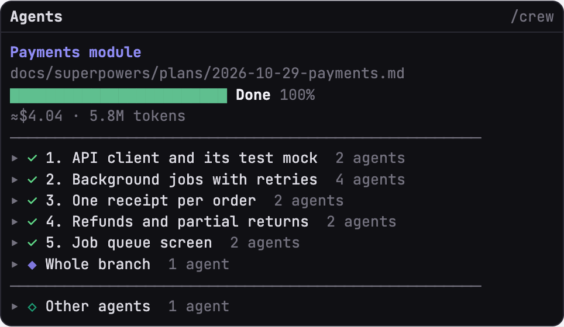

# agent-crew

A Claude Code mod: an **Agents** side panel for any session where Claude sends subagents to work. For each agent it shows **what it is doing** right now (`✎ Editing lib/export/csv.ts`, `⌕ Reading src/auth/session.ts`), **how far along it is** and **what it has cost**. When Claude keeps a task list, that list becomes the plan, with each agent under its task. With a [superpowers](https://github.com/anthropics/claude-plugins-official) plan running, it follows the plan and shows whether each agent is implementing, reviewing, fixing or doing the final review, drawn as pixel crabs. It opens by itself; there is no command to run.

## Screenshots

Drawn by the mod's own code from sample sessions (`bun scripts/preview.ts`).

**Any session**

<table>
  <tr>
    <td></td>
    <td></td>
  </tr>
  <tr>
    <td align="center">Claude keeps a task list</td>
    <td align="center">No task list</td>
  </tr>
  <tr>
    <td></td>
    <td></td>
  </tr>
  <tr>
    <td align="center">Desktop app, task list</td>
    <td></td>
  </tr>
</table>

**With a superpowers plan**

<table>
  <tr>
    <td></td>
    <td></td>
  </tr>
  <tr>
    <td align="center">Terminal, mid-plan</td>
    <td align="center">Desktop app, mid-plan</td>
  </tr>
  <tr>
    <td></td>
    <td></td>
  </tr>
  <tr>
    <td align="center">Terminal, plan done</td>
    <td></td>
  </tr>
</table>

## What it shows

- **What each agent is doing**: a live line under its name from its latest tool call (`✎ Editing`, `⌕ Reading`, `⌕ Searching`, `▶ Running`, `⇣ Fetching`, `↳ Starting`), in every view.
- **How far along each agent is**: its own task list when it keeps one (`3/5 · Writing the tests`, a solid bar); otherwise the steps it has taken (`14 steps`) beside its context fill. Superpowers implementers report steps through the `step` tool instead.
- **What each agent costs**: an estimate from its tokens at list prices, beside its model and time.
- **Claude's task list as the plan**: when the main conversation keeps a task list, the panel shows your prompt as the heading, `Tasks n/N`, and the tasks; each agent sits under the task in progress when it started (agents started before the list, under **Other agents**). When the list is done, the next agent goes back to the view without a list. Claude only keeps a task list when Claude Code gives it the task tools: on current builds (2.1.314) that takes `CLAUDE_CODE_ENABLE_TASKS=true` and `CLAUDE_CODE_ENABLE_TODO_TOOLS=true` (in your shell, or under `env` in `~/.claude/settings.json`); without them you get the view without a list.
- **No task list**: `3 agents · 2 working · 1 done`, a bar of agents finished, the working agents, then the finished ones folded to one line each.
- **Plan view** while superpowers runs a plan (subagent-driven or inline): the plan's title and file, a progress bar (`Tasks 2/5`, then `Review 5/5`, then `Done`), cost, tokens and time; a line; then **one list of tasks** (✓ complete, ● current, ◷ waiting). Each task holds its agents and opens or closes on a click; the current task starts open. Inside, each agent by its own name (the label Claude gave it), then its role in its colour, model, status, time, cost and findings; a running agent adds its bar and step. **Whole branch** holds the final review, **Other agents** the agents outside the plan.
- **Progress from the ledger**: done tasks come from superpowers' `progress.md`, found by the workspace's `plan-path` marker even when a script's output was captured, and read again every few seconds. `/crew` with no plan showing picks up the plan in progress.
- **No agent list under the prompt**: the mod ships a default `subagentStatusLine` (its `settings.json`) that blanks Claude Code's own rows there, since the panel shows them. `/tasks` and `↓ to manage` still work. To get the rows back, set your own `subagentStatusLine` in `~/.claude/settings.json`; a user setting overrides a plugin's.
- **Click an agent** in the panel to put its transcript in the main view, as picking it in Claude Code's own agent list does; click it again, or `← Back to main`, to return. An agent that has left Claude Code's list can no longer be shown, and a toast says so.
- Roles by the labels superpowers gives its agents:

  | Label | Shown as |
  | --- | --- |
  | `Implement Task N: …` | implementing (blue engineer) |
  | the task's implementer again | fixing · round R (orange engineer) |
  | `Review Task N (spec + quality)` | reviewing (amber detective) |
  | `Re-review Task N fix round R` | re-reviewing · round R (orange detective) |
  | `Review code changes`, once every task is complete | final review (violet astronaut) |
  | anything else | its agent type, in a colour per type (Explore teal, general-purpose rose; plain crab, Explore wears a pirate hat) |

Task progress comes from the plan's `### Task N:` headings and superpowers' progress ledger (`Task N: complete`), so it survives compaction.

**Step counters.** When an implementer starts, the mod adds one paragraph to its instructions asking it to report its steps with the `step` tool (`mcp__agent-crew__step`); its row then shows `2/5 · reversal`. No other agent's instructions change, and no agent's model does. Costs are estimates from token counts at list prices.

## The row above the prompt

One row sums up the session, in place of a separate band and status line:


- **Total progress**: while a plan or Claude's task list runs, its title and bar (`Tasks 3/5`) and how many agents are working; agents without either, `2 working · 1 done` with a bar of the ones finished; nothing when nothing runs. A finished plan shows `Done` until something else runs.
- **Model and effort** of the main session (`Opus 5.5 · high`), the git **branch** (none outside a repository), and the **context** fill (amber from 65%, red from 85%).
- **Prompt-cache countdown** from Claude's last answer (1-hour cache): `…` while Claude works, a frame around the row that is white at rest, amber at 20 minutes left and red at 10, and a notification at 10 and 5 minutes left (Claude Code's own notification, so it reaches the phone too; a toast when it is not delivered).
- `/crew row` hides or shows it. Narrow windows drop the branch first, then the bars.

## Install

```
/plugin marketplace add Rest95/agent-crew
/plugin install agent-crew@agent-crew
```

Restart Claude Code to load it (an update needs a restart too). It replaces claude-kit's session-band and a custom status line; uninstall or switch those off to avoid showing things twice. Claude Code docks the panel beside the chat and opens it unasked only when the terminal is at least 144 columns wide; `/crew` opens or closes it by hand at any width.

## Develop

```
claude plugin test plugins/agent-crew
claude plugin validate plugins/agent-crew
bun scripts/preview.ts > preview/index.html   # the panel at three moments, drawn by hooks/art.ts
```

Design and plan: `docs/superpowers/`.

## Credits

The crab sprites and costumes are adapted from savvy-progress in [claude-kit](https://github.com/johnnyvizz/claude-kit) (MIT, © 2026 johnnyvizz). See `LICENSE`.
