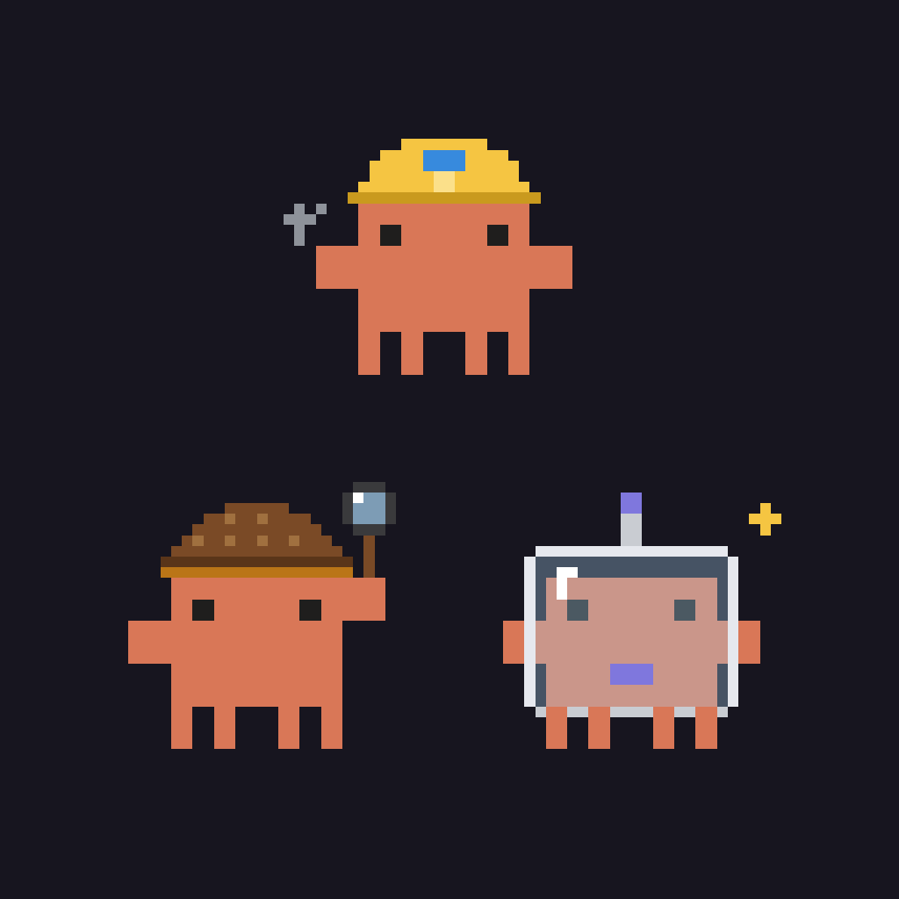
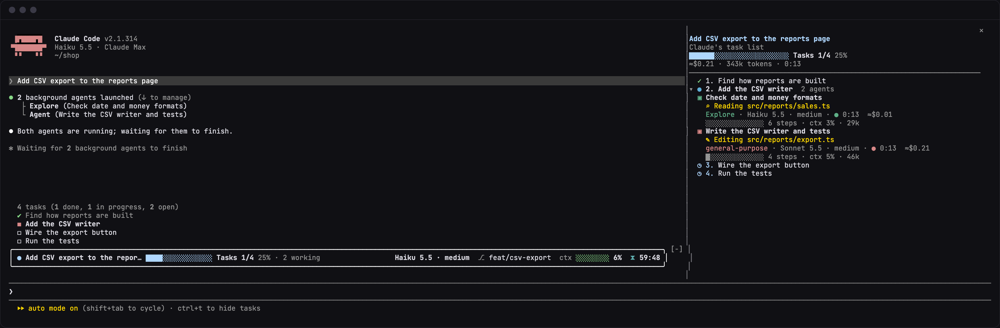
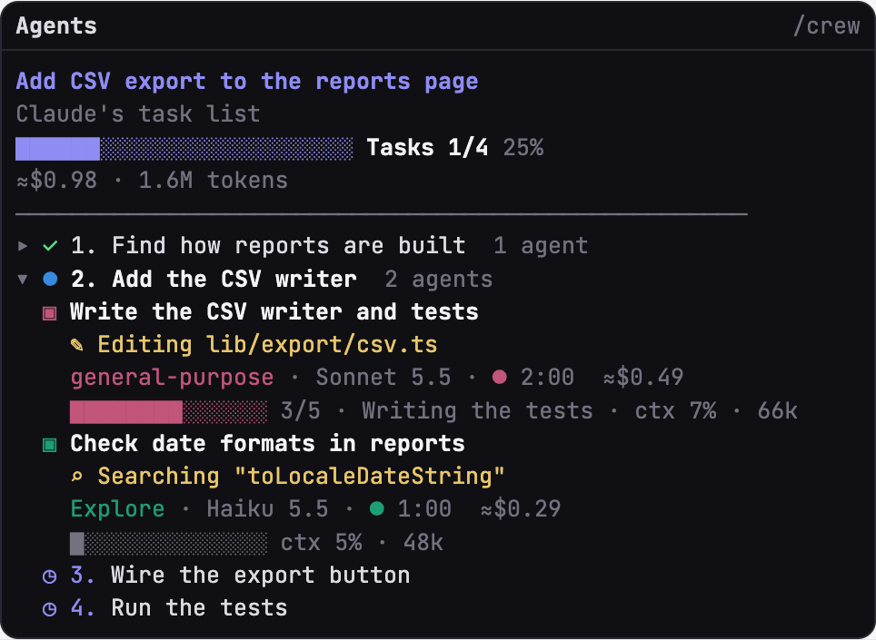
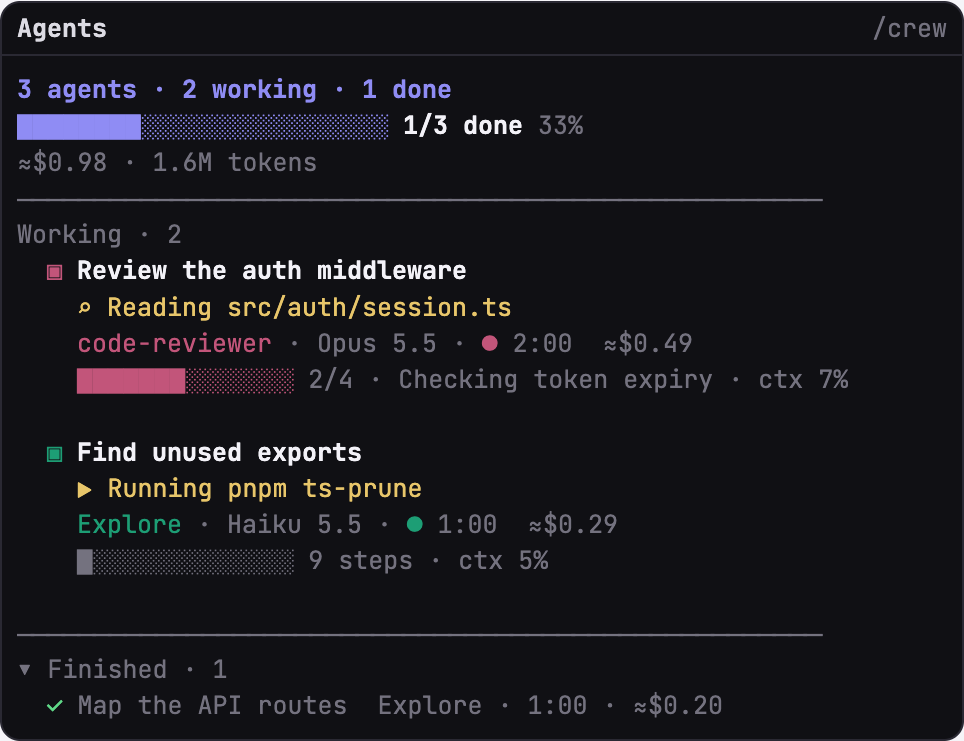
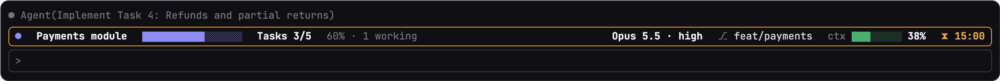
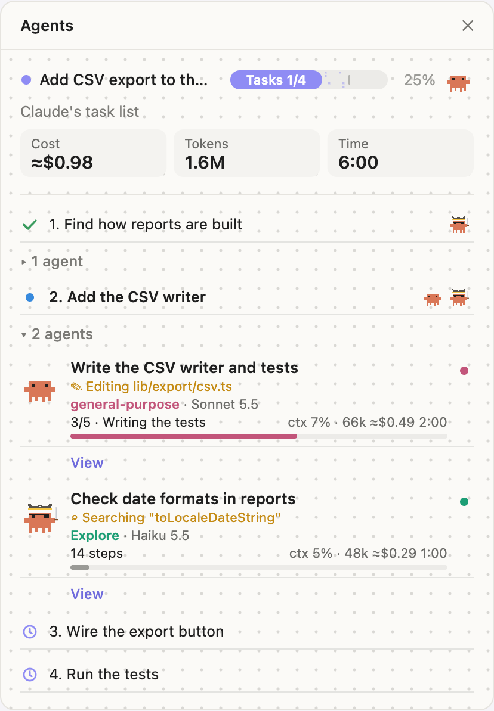
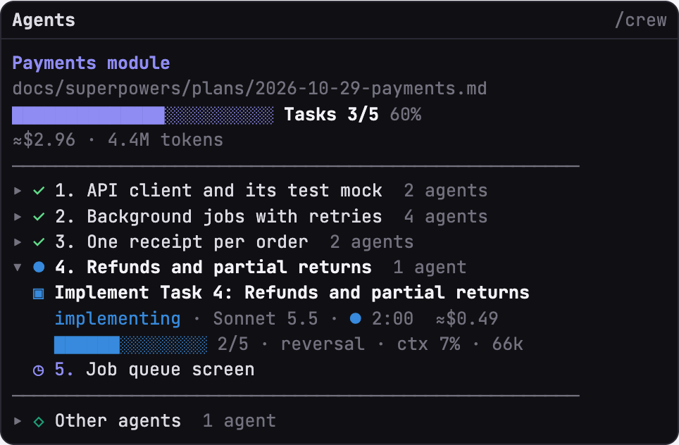
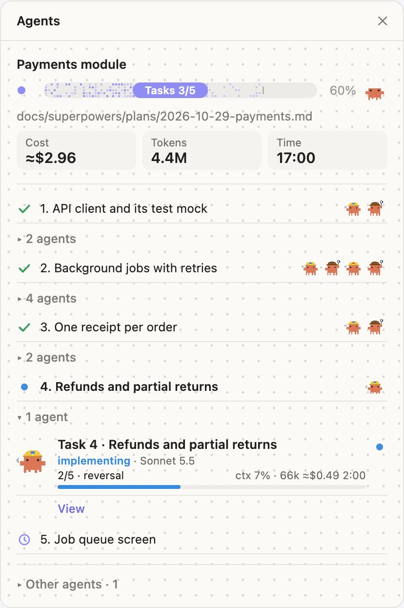

<p align="center">
  
</p>

<h1 align="center">agent-crew</h1>

<p align="center">
  <strong>See what every subagent is doing, how far along it is and what it costs.</strong><br>
  A live side panel and status row for <a href="https://code.claude.com/docs">Claude Code</a>. No setup, no new commands to learn.
</p>

<p align="center">
  <a href="https://github.com/Rest95/agent-crew/blob/main/plugins/agent-crew/.claude-plugin/plugin.json"></a>
  <a href="LICENSE"></a>
  
</p>

<p align="center">
  <a href="#install">Install</a> ·
  <a href="#features">Features</a> ·
  <a href="#a-closer-look">A closer look</a> ·
  <a href="#options">Options</a> ·
  <a href="#with-superpowers-plans">Superpowers</a> ·
  <a href="#troubleshooting">Troubleshooting</a>
</p>

<p align="center">
  
  <br>
  <sub>A real session on a sample project, with Claude's task tools turned on.</sub>
</p>

## Why

When Claude sends subagents off to work, you get a spinner and a list of names. agent-crew shows you the work itself: which file each agent is touching, how far it has got, and how much it has spent, so you can tell at a glance whether things are moving or stuck.

## Install

In Claude Code:

```
/plugin marketplace add Rest95/agent-crew
/plugin install agent-crew@agent-crew
```

Restart Claude Code to load it. The panel opens by itself the next time a subagent starts. Updates need a restart too.

## Features

- **What each agent is doing, live.** A line under its name from its latest tool call: `✎ Editing lib/csv.ts`, `⌕ Reading src/auth.ts`, `▶ Running npm test`.
- **How far along it is.** Its own checklist when it keeps one (`3/5 · Writing the tests`), otherwise the steps it has taken (`14 steps`) beside its context fill.
- **What it costs.** A running estimate per agent, plus totals for the session.
- **Your work as a plan.** When Claude keeps a task list, the panel shows your prompt, a `Tasks 1/4` bar and each agent under its task.
- **One row above the prompt.** Progress, model and effort, git branch, context fill and a prompt-cache countdown with a warning before it expires.
- **Click to open.** Click an agent to see its transcript in the main view.
- **Fits your theme.** Terminal colours follow your Claude Code theme, light or dark.
- **Works in the background.** It never slows a tool call, and it makes no network calls: everything stays on your machine.

## A closer look

### Any session

| When Claude keeps a task list | When it just sends agents out |
| --- | --- |
|  |  |

Each action follows the agent's latest tool call, and finished agents fold down to one line. The bar counts tasks when there's a task list, and finished agents when there isn't.

### The row above the prompt



| Piece | What it shows |
| --- | --- |
| Progress | The task list or plan with its bar, or `2 working · 1 done` |
| Model | The main session's model and effort |
| Branch | The current git branch |
| Context | How full the context is: amber from 65%, red from 85% |
| Cache | Time left on the prompt cache, from Claude's last answer |

The frame is your theme's text colour at rest, amber with 20 minutes of cache left and red with 10. You also get a notification at 10 and 5 minutes. When it's tight, the row drops whole pieces rather than cutting them: the working count, then the branch, then the bars.

### In the desktop app



The desktop panel carries the same information, drawn with the crew of pixel crabs.

<sub>The images in this section are drawn by the mod's own code from sample sessions (`bun scripts/preview.ts`).</sub>

## Commands

| Command | What it does |
| --- | --- |
| `/crew` | Opens or closes the panel. With no plan showing, picks up a superpowers plan in progress. |
| `/crew row` | Hides or shows the row above the prompt. |

## Options

Set these in `/config`, or under `pluginConfigs` in `~/.claude/settings.json`.

| Option | Default | What it does |
| --- | --- | --- |
| `open_panel` | on | Opens the panel when a subagent starts. Off: open it with `/crew`. |
| `hide_agent_list` | on | Hides Claude Code's own agent list under the prompt, since the panel shows the same agents. Off: the list stays. Takes effect in new sessions. |

## How it works

agent-crew is a Claude Code mod. It listens to tool calls and subagent events, and draws the panel and row from them.

- **Actions and steps** come from each agent's own tool calls, matched by agent id.
- **Tasks** come from Claude's `TaskCreate`, `TaskUpdate` and `TodoWrite` calls in the main conversation. A subagent's own list counts as its progress and never touches yours.
- **Placement** is decided when an agent starts: it goes under the task in progress, or the best match by name when several are. Agents outside any task go under **Other agents**.
- **Costs** are estimates from token counts at list prices, not your bill.

Agents' instructions and models are left alone. The one exception is superpowers implementers, described below.

## With superpowers plans

When a [superpowers](https://github.com/anthropics/claude-plugins-official) plan runs, subagent-driven or inline, the panel follows the plan: its title and file, `Tasks 2/5`, then `Review 5/5`, then `Done`, with each agent's role in the task.

| Terminal | Desktop app |
| --- | --- |
|  |  |

<sub>Drawn by the mod's own code from a sample plan.</sub>

<details>
<summary>How agents get their roles</summary>

| Label Claude gives the agent | Shown as |
| --- | --- |
| `Implement Task N: …` | implementing (blue engineer) |
| The task's implementer again, after a review found something | fixing · round R (orange engineer) |
| `Review Task N (spec + quality)` | reviewing (amber detective) |
| `Re-review Task N fix round R` | re-reviewing · round R (orange detective) |
| `Review code changes`, once every task is complete | final review (violet astronaut) |
| Anything else | its agent type, with a colour per type |

</details>

<details>
<summary>Where plan progress comes from</summary>

Tasks come from the plan's `### Task N:` headings, and completed tasks from superpowers' ledger (`Task N: complete` in `progress.md`), so progress survives compaction. The ledger is read again every few seconds.

To show step counters, the mod adds one paragraph to an implementer's instructions, asking it to report steps with the `step` tool. That tool joins a session only when the first implementer starts, so other sessions never carry it.

</details>

When a plan is running it takes priority over Claude's task list. Once it's finished, it gives way to a task list still at work.

## Troubleshooting

<details>
<summary>The panel didn't open</summary>

Claude Code opens the panel by itself only when the terminal is at least 144 columns wide. Use `/crew` to open it at any width. Check that `open_panel` is on, too.

</details>

<details>
<summary>I never see the task-list view</summary>

Claude only keeps a task list when Claude Code offers it the task tools. On current builds (2.1.314) that takes two environment variables, in your shell or under `env` in `~/.claude/settings.json`:

```
CLAUDE_CODE_ENABLE_TASKS=true
CLAUDE_CODE_ENABLE_TODO_TOOLS=true
```

Without them you get the view without a task list, which shows every agent the same way.

</details>

<details>
<summary>I want Claude Code's agent list back</summary>

Turn off `hide_agent_list` and start a new session. `/tasks` and `↓ to manage` work either way.

</details>

<details>
<summary>An agent says its transcript isn't available</summary>

Claude Code can only show agents still in its own list. Once an agent has left that list, the panel says so instead.

</details>

<details>
<summary>The cost doesn't match my bill</summary>

Costs are estimates from token counts at list prices. A model missing from the mod's price table uses a default rate.

</details>

## Development

```
claude plugin test plugins/agent-crew       # the test suite
claude plugin validate plugins/agent-crew   # what the engine would refuse
bun scripts/preview.ts > preview/index.html # every view, drawn by hooks/art.ts
```

The logic lives in `hooks/model.ts`, the drawing in `hooks/art.ts` and the wiring in `hooks/register.tsx`. Designs and plans are in [`docs/superpowers/`](docs/superpowers/).

## Credits

The crab sprites and costumes are adapted from savvy-progress in [claude-kit](https://github.com/johnnyvizz/claude-kit) (MIT, © 2026 johnnyvizz). See [`LICENSE`](LICENSE).

## License

[MIT](LICENSE)
